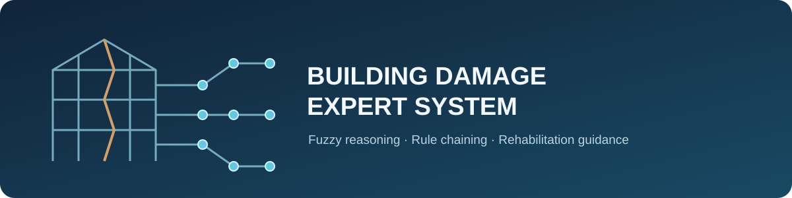

# Building Damage Expert System

<p align="center">
  
</p>

<p align="center">
  
  
  
  
</p>

## About

A compact Python expert-system prototype for post-war building damage assessment. It combines fuzzy logic (`scikit-fuzzy`) with forward and backward rule chaining to interpret observations such as crack width and water damage, estimate a damage grade informed by EMS-98, and suggest structural rehabilitation actions.

**Intended for educational and preliminary decision-support use only.** It does not replace an on-site inspection, a qualified structural engineer, or an official EMS-98 assessment.

## Tech stack

- **Python** — implementation
- **scikit-fuzzy** — fuzzy sets and membership functions
- **NumPy** — numerical ranges and calculations
- **Matplotlib** — membership-function visualization
- **Jupyter Notebook** — interactive project workflow

## Quick start

1. Clone the repository and enter its directory:

   ```bash
   git clone https://github.com/<your-username>/building-damage-expert-system.git
   cd building-damage-expert-system
   ```

2. Create and activate a virtual environment, then install the dependencies:

   ```bash
   python -m venv .venv
   # Windows PowerShell
   .\.venv\Scripts\Activate.ps1
   # macOS/Linux: source .venv/bin/activate

   python -m pip install numpy scikit-fuzzy matplotlib notebook
   ```

3. Launch the notebook:

   ```bash
   jupyter notebook "Expert system Final .ipynb"
   ```

Run the notebook cells in order to inspect the fuzzy variables, assessment rules, chaining examples, and visualizations.

## Project structure

```text
building-damage-expert-system/
├── assets/
│   └── banner.svg
├── Expert system Final .ipynb
├── Expert System Final project Report.docx
└── README.md
```

## Assessment workflow

1. Provide observed building-damage indicators.
2. Fuzzify the inputs and evaluate the defined expert rules.
3. Use forward chaining to identify matching conclusions, or backward chaining to test a target conclusion.
4. Review the estimated damage grade and the associated rehabilitation recommendation.

Damage grades and recommendations depend on the rules and membership functions encoded in the notebook; have all real-world findings reviewed by a qualified structural professional.
